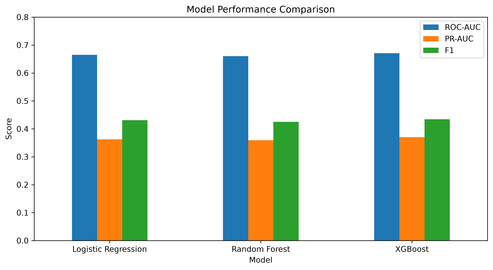
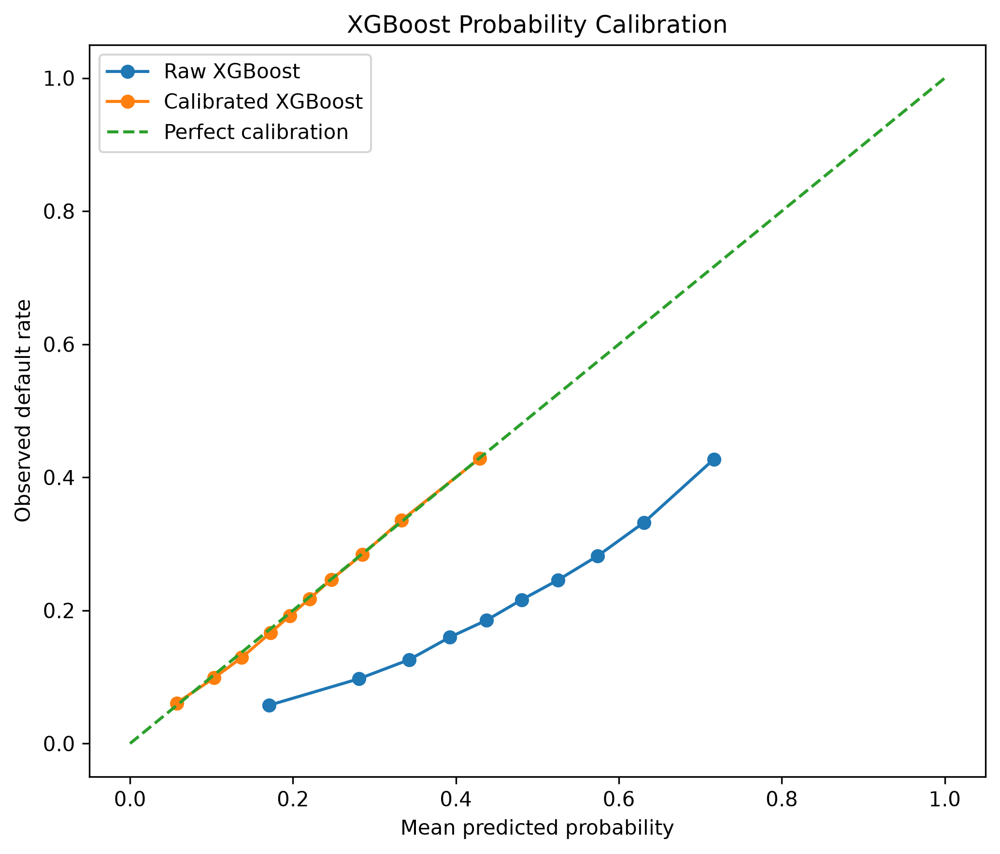
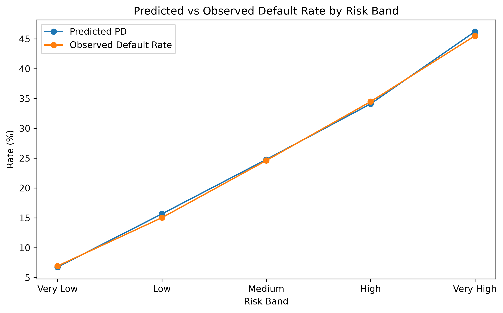
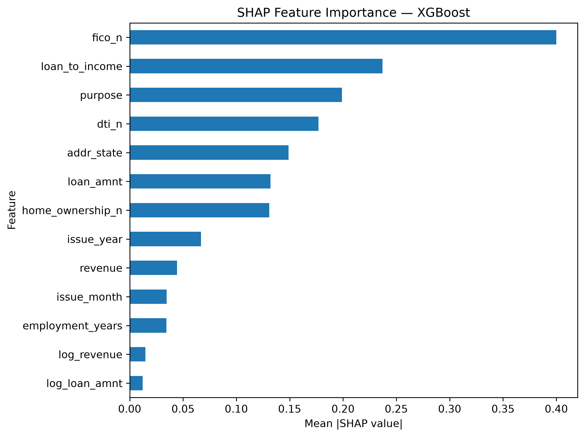

# Credit Risk & Loan Default Prediction

An end-to-end machine learning project for predicting borrower default risk and converting model predictions into calibrated probability-of-default (PD) risk bands.

## Overview

This project develops a credit-risk prediction pipeline using borrower demographic, financial, loan application, and historical lending data.

The project focuses on more than simply predicting whether a borrower will default. The final XGBoost model is calibrated to produce more reliable probability-of-default estimates, which are then converted into interpretable risk bands for scorecard-style underwriting decisions.

### Key outcomes

- Built and evaluated Logistic Regression, Random Forest, and XGBoost models.
- Used a time-based train/validation/test split to simulate out-of-time model performance.
- Handled class imbalance using class weighting / positive-class weighting.
- Performed feature engineering on borrower and loan characteristics.
- Calibrated XGBoost probabilities using isotonic regression.
- Reduced test Brier score from **0.2177 to 0.1558** after calibration.
- Created five borrower risk bands from calibrated PD estimates.
- Used SHAP to interpret the model's most influential features.

---

## Problem Statement

Credit-risk models need to distinguish borrowers with different probabilities of default while producing probabilities that are useful for risk-based decision making.

The objective of this project is to:

1. Predict the probability that a borrower will default.
2. Compare multiple machine learning approaches.
3. Evaluate performance using discrimination and classification metrics.
4. Calibrate predicted probabilities.
5. Segment borrowers into interpretable risk bands.
6. Identify the factors driving model predictions.

---

## Dataset

The dataset contains **1,347,681 loan records** and includes borrower, loan, employment, geographic, and application-level information.

Original variables include:

- Revenue
- Debt-to-income ratio (DTI)
- Loan amount
- FICO score
- Employment length
- Loan purpose
- Home ownership
- State
- Loan issue date
- Default indicator
- Other application metadata

The target variable is:

`Default`

where:

- `0` = No default
- `1` = Default

### Class distribution

| Class | Count | Percentage |
|---|---:|---:|
| No Default | 1,078,432 | 80.02% |
| Default | 269,249 | 19.98% |

Because the target is imbalanced, class weighting was incorporated during model training.

---

## Data Preparation & Feature Engineering

The dataset was cleaned and transformed before modeling.

### Feature engineering

The following features were derived:

- `issue_year`
- `issue_month`
- `loan_to_income`
- `log_revenue`
- `log_loan_amnt`
- `employment_years`
- DTI bands
- FICO bands

Special handling was applied to the anomalous DTI value of `999`, which was treated as missing during feature preparation.

High-missingness text fields such as `desc` were not used in the initial predictive modeling pipeline.

### Modeling features

The final modeling matrix contains **13 features**, including:

- `revenue`
- `dti_n`
- `loan_amnt`
- `fico_n`
- `purpose`
- `home_ownership_n`
- `addr_state`
- `issue_year`
- `loan_to_income`
- `log_revenue`
- `log_loan_amnt`
- `issue_month`
- `employment_years`

Categorical variables were one-hot encoded using a `ColumnTransformer`.

---

## Temporal Train / Validation / Test Split

Instead of randomly splitting the data, the project uses a chronological split to better represent how a credit-risk model would perform on future loans.

| Dataset | Period | Records | Default Rate |
|---|---|---:|---:|
| Train | 2007–2015 | 829,347 | 18.46% |
| Validation | 2016 | 293,057 | 23.28% |
| Test | 2017–2018 | 225,277 | 21.29% |

The test set is therefore an out-of-time evaluation set rather than a random sample of the training distribution.

---

## Models

Three models were benchmarked:

1. Logistic Regression
2. Random Forest
3. XGBoost

### Validation performance

| Model | ROC-AUC | PR-AUC | F1 |
|---|---:|---:|---:|
| Logistic Regression | 0.6650 | 0.3625 | 0.4312 |
| Random Forest | 0.6604 | 0.3590 | 0.4248 |
| **XGBoost** | **0.6709** | **0.3706** | **0.4343** |

XGBoost achieved the strongest validation performance across all three reported metrics and was therefore selected for probability calibration and downstream risk segmentation.



---

## Probability Calibration

A model's ranking ability is different from its ability to produce reliable probabilities.

The selected XGBoost model was calibrated using **isotonic regression** on the validation set.

### Brier score

| Model | Test Brier Score |
|---|---:|
| Raw XGBoost | 0.2177 |
| **Calibrated XGBoost** | **0.1558** |

The reduction in Brier score indicates substantially improved probability quality after calibration.



Only a very small number of predictions were exactly at the probability boundaries:

- PD = 0: 22 borrowers
- PD = 1: 2 borrowers

This indicates that boundary predictions were not widespread.

---

## Risk Segmentation

Calibrated probabilities were converted into five risk bands:

- Very Low: PD ≤ 10%
- Low: 10–20%
- Medium: 20–30%
- High: 30–40%
- Very High: >40%

### Risk-band performance

| Risk Band | Borrowers | Predicted PD | Observed Default Rate |
|---|---:|---:|---:|
| Very Low | 35,148 | 6.74% | 6.93% |
| Low | 77,188 | 15.66% | 15.03% |
| Medium | 65,861 | 24.77% | 24.60% |
| High | 33,565 | 34.10% | 34.47% |
| Very High | 13,515 | 46.21% | 45.50% |

The observed default rate increases consistently across the risk bands, while remaining close to the corresponding predicted PD.



This provides evidence that the calibrated probabilities can be translated into meaningful borrower risk segments.

---

## Model Interpretation

SHAP was used to understand which features have the greatest influence on the XGBoost model.

### Aggregated feature importance

| Rank | Feature | Mean \|SHAP\| |
|---:|---|---:|
| 1 | FICO score | 0.3999 |
| 2 | Loan-to-income | 0.2369 |
| 3 | Purpose | 0.1990 |
| 4 | DTI | 0.1770 |
| 5 | State | 0.1488 |
| 6 | Loan amount | 0.1320 |
| 7 | Home ownership | 0.1309 |
| 8 | Issue year | 0.0670 |
| 9 | Revenue | 0.0443 |
| 10 | Issue month | 0.0346 |
| 11 | Employment years | 0.0344 |
| 12 | Log revenue | 0.0146 |
| 13 | Log loan amount | 0.0122 |

FICO score, loan-to-income ratio, DTI, and loan characteristics were among the strongest contributors to model predictions.



---

## Project Pipeline

```text
Raw Lending Data
       │
       ▼
Data Cleaning & EDA
       │
       ▼
Feature Engineering
       │
       ▼
Temporal Train / Validation / Test Split
       │
       ▼
Preprocessing & One-Hot Encoding
       │
       ▼
Class-Imbalance Handling
       │
       ▼
Model Benchmarking
 ┌─────┼──────────┐
 ▼     ▼          ▼
LR     RF       XGBoost
                 │
                 ▼
        Probability Calibration
          (Isotonic Regression)
                 │
                 ▼
        Probability of Default
                 │
                 ▼
           Risk Segmentation
                 │
                 ▼
        Model Interpretation
              (SHAP)